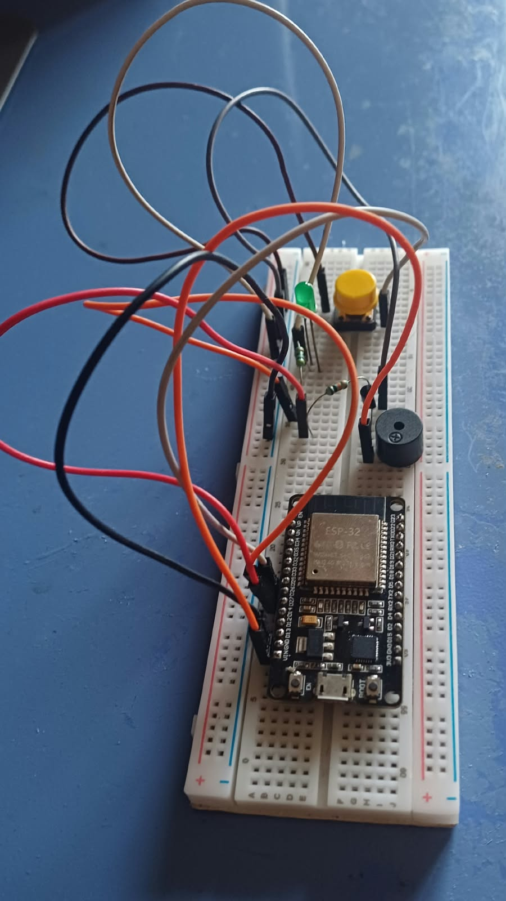
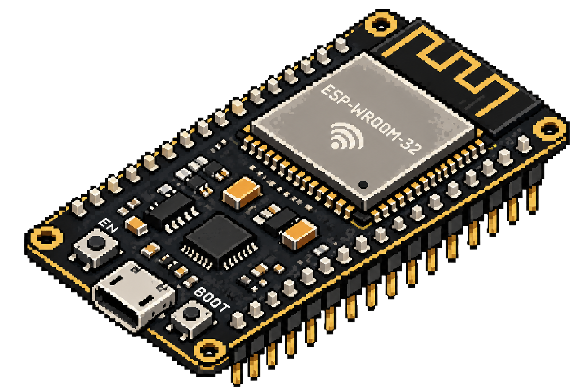

# 🛡️ Hardware-Isolated Security Vault

<p align="center">
  
</p>

<p align="center">
  <strong>An air-gapped cryptographic hardware security token with physical button 2FA, on-chip mbedTLS SHA-256 encryption, non-volatile flash persistence, and a real-time Web Serial API console.</strong>
</p>

<p align="center">
  
  
  
  
  
  
</p>

---

## 📌 Overview

Traditional software password managers store sensitive keys in host RAM, leaving them vulnerable to background malware, RATs, keyloggers, and memory scrapers.

The **Hardware-Isolated Security Vault** establishes a physical silicon boundary using an ESP32:
* **Physical 2FA Tactile Proof-of-Presence**: Cryptographic actions are frozen until the physical pushbutton is clicked. Remote malware cannot trigger operations.
* **100% On-Chip Cryptography**: SHA-256 hashing runs exclusively inside ESP32 hardware via `mbedTLS`. The host browser never sees or derives keys.
* **Autonomous Hardware Decision Gate**: The ESP32 independently renders ACCEPT or REJECT verdicts. Client software cannot spoof or bypass authorization.
* **Non-Volatile Flash Persistence**: Hashes are stored in ESP32 Non-Volatile Storage (NVS) flash partitions (`vault_data`), surviving complete power cycles with zero browser cookies or disk footprint.

---

## 📸 Hardware Setup & Pinout

<p align="center">
  
</p>

### Wiring Connections

| Component | ESP32 Pin | Mode | Details |
| :--- | :---: | :---: | :--- |
| **Tactile Pushbutton (2FA)** | `GPIO 25` | `INPUT_PULLUP` | One leg to `GPIO 25`, other to `GND`. Triggers debounced interrupt on `FALLING` edge. |
| **Armed Status LED** | `GPIO 26` | `OUTPUT` | Anode (+) through 220Ω resistor to `GPIO 26`; Cathode (-) to `GND`. |
| **Piezo Audio Buzzer** | `GPIO 27` | `OUTPUT` | Positive (+) lead to `GPIO 27`; Negative (-) lead to `GND`. |
| **UART Serial TX/RX** | `GPIO 1 / 3` | Serial `115200` | Full duplex UART over onboard USB bridge. |
| **Common Ground** | `GND` | Ground | Shared ground rail for all components. |

---

## 🧠 System Architecture & Dataflow

```
[ UNTRUSTED HOST BROWSER ]
   │
   │  Web Serial API (UART 115200 8N1)
   │  CREATE:password / VERIFY:password
   ▼
[ ESP32 HARDWARE VAULT ]
   ├── UART Receiver ──> Moore FSM (IDLE ➔ ARMED)
   ├── GPIO 25 Interrupt ──> Physical Button Presence Check
   │     ├── 1 Click  ──> ACCEPT / COMMIT
   │     ├── 2 Clicks ──> REJECT / ABORT
   │     └── 0 Clicks ──> 5-Second Timeout Alarm
   ├── mbedTLS Core ──> Hardware SHA-256 Engine
   └── NVS Partition ("vault_data") ──> Secure Hash & Audit Log Storage
```

---

## 🕹️ Operator Gesture Controls

When a command is received, the vault enters **ARMED** state (LED illuminates, 100ms audio chirp):

| Gesture | Window | Action & System Reaction |
| :--- | :---: | :--- |
| **1 Click** | Evaluated after 1.0s | **ACCEPT / COMMIT**: Hardware calculates SHA-256. If `CREATE`, stores in NVS. If `VERIFY`, checks against stored hash. Emits double success chirp. |
| **2 Clicks** | Immediate | **REJECT / ABORT**: Halts immediately. Disarms, sounds a 1-second warning tone, and reports user cancellation. |
| **0 Clicks (Timeout)** | > 5 Seconds | **ANTI-BOT ALARM**: Triggers a 2-second siren, logs timeout to NVS audit counters, and resets to `IDLE`. |

---

## 📡 Serial Protocol (UART 115200 8N1)

| Direction | Packet Format | Description |
| :--- | :--- | :--- |
| **Host ➔ ESP32** | `CREATE:<password>\n` | Request new password enrollment into hardware NVS. |
| **Host ➔ ESP32** | `VERIFY:<password>\n` | Request candidate password verification. |
| **ESP32 ➔ Host** | `ARMED: 1 Click = ACCEPT \| 2 Clicks = REJECT` | Vault is armed, awaiting physical presence confirmation. |
| **ESP32 ➔ Host** | `SUCCESS:<sha256_hash>` | Operation authorized; returns hardware-computed hash. |
| **ESP32 ➔ Host** | `ERROR:Mismatch - Wrong Password!` | Verification failed; mismatch recorded in flash. |
| **ESP32 ➔ Host** | `ERROR:Timeout - Physical presence not detected!` | 5-second inactivity timeout triggered. |
| **ESP32 ➔ Host** | `ERROR:Rejected - User aborted operation!` | Operator double-clicked to cancel. |

---

## 🚀 Quickstart Guide

### 1. Flash the ESP32 Firmware
1. Open [sketch_oct18a.ino](sketch_oct18a/sketch_oct18a.ino) in the **Arduino IDE**.
2. Select your board under **Tools > Board > esp32 > ESP32 Dev Module**.
3. Set **Upload Speed** to `921600` (or `115200`) and choose your ESP32's COM port.
4. Click **Upload**. Open Serial Monitor at **115200 baud** to verify initial flash boot:
   ```text
   [SYSTEM BOOT] Flash Memory Loaded.
   - Failed Attempt (Timeouts): 0
   - Failed Attempt (Mismatches): 0
   ```

### 2. Run the Web Serial Dashboard
The dashboard requires no backend server. Simply serve it statically or open in a Web Serial browser (Chrome, Edge, Opera):

```bash
# Optional: Launch simple local server
python -m http.server 8000
```
Open `http://localhost:8000/vault_1.html` (or `index.html`).

### 3. Usage
1. Click **"Connect to ESP32 Gateway"** and pair with your ESP32 serial port.
2. Under **"Create Password"**, enter a password and click **Encrypt & Commit**.
3. Press the physical button **once** to confirm.
4. Use **"Verify Password"** and confirm with 1 click to authenticate against hardware.

---

## 📂 Repository Structure

```text
├── Circuit.jpg            # Prototype breadboard circuit photo
├── esp32-board.png        # ESP32 pinout illustration
├── grid-pattern.png       # Web UI styling asset
├── Home Page.svg          # UI Design mockup (Home)
├── Main.svg               # UI Design mockup (Main)
├── index.html             # Web Serial cyberpunk dashboard
├── vault_1.html           # Web Serial cyberpunk dashboard (formatted)
├── sketch_oct18a/
│   └── sketch_oct18a.ino  # ESP32 C++ firmware (FSM, mbedTLS, NVS, ISR)
└── README.md              # Project documentation
```

---

## 👥 Built By

Developed as an embedded security hardware project by:
* **Piyush Lohia** (25BCE2527)
* **Yash Agarwal** (25BCE2531)

---

## 📜 License

This project is open-source under the [MIT License](https://opensource.org/licenses/MIT).
